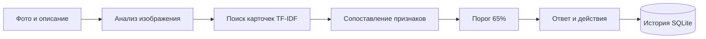

<div align="center">

# 🥔 Agronom AI

**Помощник агронома для предварительной диагностики картофеля**

Фото и описание → гипотеза заболевания → возможные условия → действия

`Python` · `FastAPI` · `React` · `OpenCV` · `SQLite` · `TF-IDF`

[Быстрый старт](#быстрый-старт) · [Структура](#структура-проекта) · [Как работает](#как-это-работает) · [Документация](#документация)

</div>

---

Учебный прототип локального веб-приложения. Анализирует листья и клубни картофеля,
учитывает описание симптомов и сохраняет результаты проверок.

> После установки зависимостей приложение работает без интернета: модели,
> база знаний и интерфейс находятся на компьютере. Python-сервер должен быть запущен.

## Возможности

- 📷 Проверка фотографии с описанием или без него.
- 🌿 Отдельные модели для листьев и клубней; наблюдение видимой поверхности стебля.
- 🔎 Поиск по внутренней базе знаний через TF-IDF.
- 🎯 Показ гипотез только при оценке **от 65% включительно**.
- 💬 Уточняющие вопросы при неоднозначных признаках.
- 📋 Возможные условия развития заболевания и рекомендуемые действия.
- 🗂️ История проверок в SQLite.

## Быстрый старт

Нужны **Python, Node.js и npm**. Проект проверялся на Python 3.12.
Откройте терминал в корне проекта. Команды ниже приведены для Windows PowerShell.

**1. Установите зависимости и соберите интерфейс:**

```powershell
python -m pip install -r requirements.txt
npm.cmd ci --prefix react-frontend
npm.cmd run build --prefix react-frontend
```

**2. Запустите сервер:**

```powershell
python -m uvicorn main:app --app-dir backend --reload
```

**3. Откройте [localhost:8000](http://127.0.0.1:8000).**

После первой подготовки для запуска достаточно открыть **`start.bat`**.
Выберите часть растения, прикрепите фото и отправьте сообщение. Текст можно добавить
позже как уточнение. Новое фото начинает проверку нового образца.

<details>
<summary><strong>Разработка интерфейса и частые вопросы</strong></summary>

Для разработки React с автоматическим обновлением запустите отдельный терминал:

```powershell
npm.cmd run dev --prefix react-frontend
```

Python-сервер также должен работать. Адрес страницы разработки напечатает Vite.

- После правки `src/` выполните `npm.cmd run build --prefix react-frontend`, чтобы
  обновить интерфейс на порту 8000. При необходимости нажмите **Ctrl+F5**.
- История показывает сохранённые ответы. Для проверки новой модели отправьте фото заново.
- При ошибке импорта Python проверьте, что пакеты установлены в выбранный интерпретатор.
- `DATABASE_URL` задаёт другую базу, а `VITE_API_URL` при сборке — другой адрес API.
  Для обычного запуска эти переменные не нужны.

</details>

## Структура проекта

```text
Agronom_AI/
├── backend/
│   ├── main.py                      # API и последовательность одной проверки
│   ├── app/
│   │   ├── schemas.py               # Формат запросов и ответов
│   │   ├── diagnostics/
│   │   │   ├── advisor.py           # Объединение фото, текста и знаний
│   │   │   ├── vision.py            # Подготовка фото и выбор модели
│   │   │   ├── tuber_model.py       # Запуск классификатора клубней
│   │   │   ├── symptoms.py          # Группы симптомов и их веса
│   │   │   ├── policy.py            # Порог 65% и правила показа
│   │   │   └── factors.py           # Возможные условия развития болезни
│   │   ├── knowledge/
│   │   │   ├── search.py            # Поиск похожих статей через TF-IDF
│   │   │   └── seed.py              # Начальное заполнение базы
│   │   └── storage/
│   │       ├── database.py          # Подключение к SQLite
│   │       └── models.py            # Описание таблиц
│   ├── data/
│   │   ├── knowledge/              # Карточки болезней и условия их развития
│   │   └── models/
│   │       ├── potato/             # Готовая CNN листьев
│   │       └── tuber/              # Модель клубней, веса и отчёты обучения
│   ├── scripts/
│   │   ├── import_bashinkom.py      # Сбор описаний БашИнком
│   │   ├── import_pesticidy.py      # Обновление статей Пестициды.ru
│   │   ├── convert_leaf_model.py   # Конвертация модели листьев в ONNX
│   │   ├── prepare_tuber_training.py # Подготовка данных обучения
│   │   └── train_tuber_model.py     # Обучение и оценка классификатора клубней
│   ├── tests/                      # Тесты и проверочные фотографии
│   └── agro_advisor.db             # Рабочая база знаний и история
├── react-frontend/
│   ├── src/
│   │   ├── App.jsx                 # Основной экран
│   │   ├── assessment.js           # Контекст фото и уточняющих сообщений
│   │   ├── diagnosis.js            # Подготовка результата к отображению
│   │   ├── main.jsx                # Подключение React
│   │   └── styles.css              # Стили приложения
│   ├── public/                     # Статические ресурсы
│   ├── index.html                  # HTML-оболочка
│   ├── vite.config.js              # Сборка и прокси к API
│   ├── package.json                # Зависимости и команды npm
│   └── dist/                       # Готовый интерфейс, создаётся сборкой
├── docs/                           # Памятки и подробные объяснения
├── requirements.txt                # Зависимости Python
├── start.bat                       # Запуск сервера в Windows
└── README.md
```

Дерево показывает основные файлы. `__init__.py` обозначают Python-пакеты;
`node_modules/`, `__pycache__/` и `.cache/` содержат зависимости и служебные данные.
Веса моделей находятся в `data/models/`, а `app/storage/models.py` описывает **таблицы**.

## Как это работает



Фото проходит подготовку в `vision.py`. Для листа запускается готовая CNN, для
клубня — отдельный классификатор. `search.py` находит подходящие описания,
`advisor.py` сопоставляет признаки, а `policy.py` применяет порог отображения.

Возможные условия заболевания берутся из справочника: приложение не измеряет
влажность или температуру по фотографии. Статьи и пользовательские обращения
не запускают автоматическое обучение. Облачный чат-бот не используется.

## Модели и результаты

| Объект | Метод | Что различает |
| :--- | :--- | :--- |
| Лист | Готовая локальная CNN | Альтернариоз, фитофтороз, здоровый лист |
| Клубень | MobileNetV2 + обученная голова | Пять групп заболеваний, здоровый клубень, прочие изменения |
| Стебель | Правила обработки изображения | Видимые изменения поверхности, без отдельной сети болезней |

Голова классификатора клубней обучена в проекте; свёрточные веса MobileNetV2
оставлены неизменными. После исключения четырёх конфликтующих близких дубликатов
447 фото разделены на **267 для обучения, 90 для настройки и 90 для теста**.

| Проверка клубней | Результат |
| :--- | :--- |
| Верно выбранный класс на всём тесте | **66 / 90 — 73,3%** |
| Определённые ответы при пороге 65% | **46 / 90** |
| Верные среди этих ответов | **41 / 46**, пять ошибок |

Это небольшая проверка внутри одного набора, а не подтверждённая полевая точность.
Оценка 99% не гарантирует правильность; текстовые баллы также не являются измеренной
вероятностью болезни. По одному снимку нельзя исключить скрытые повреждения.
Состав выборок и ошибки сохранены в [отчёте обучения](backend/data/models/tuber/training_report.json).

## Проверки

```powershell
python -m unittest discover -s backend/tests -p 'test_*.py' -v
node --test react-frontend/src/diagnosis.test.js react-frontend/src/assessment.test.js
npm.cmd run lint --prefix react-frontend
npm.cmd run build --prefix react-frontend
```

Серверные тесты используют временную SQLite и не меняют рабочую историю.

<details>
<summary><strong>Обновление знаний и повторение обучения</strong></summary>

Обновление статей запускается отдельно и требует доступа к сайтам:

```powershell
python backend/scripts/import_bashinkom.py
python backend/scripts/import_pesticidy.py
```

Импортер Пестициды.ru также принимает `--html-dir` для сохранённых страниц.
В базе 16 начальных карточек; несколько могут описывать одну болезнь.
Повторение обучения клубней:

```powershell
python backend/scripts/prepare_tuber_training.py
python backend/scripts/train_tuber_model.py --data .cache/tuber_training/potato-diseases.zip --output .cache/tuber_candidate
```

Кандидат сохраняется отдельно от активной модели. Данные, метрики и порядок
установки описаны в [записке об обучении](docs/ОБУЧЕНИЕ_МОДЕЛИ_КЛУБНЕЙ.txt).

</details>

## Документация

**Начните с [короткой памятки](docs/ПАМЯТКА_К_ЗАЩИТЕ.txt)** — основные файлы,
путь запроса и объяснение моделей простыми словами.

| Документ | Когда пригодится |
| :--- | :--- |
| [Полное устройство проекта](docs/ПОДРОБНОЕ_УСТРОЙСТВО_ПРОЕКТА.txt) | Разобраться в деталях отдельных файлов |
| [Обучение модели клубней](docs/ОБУЧЕНИЕ_МОДЕЛИ_КЛУБНЕЙ.txt) | Повторить обучение и прочитать результаты |
| [Лицензии и источники](docs/ЛИЦЕНЗИИ_И_ИСТОЧНИКИ.txt) | Проверить условия сторонних материалов |

## Происхождение материалов

Модель листьев: [potato-disease-classifier](https://huggingface.co/24f2004275/potato-disease-classifier).
Основа модели клубней: [MobileNetV2 ONNX Model Zoo](https://huggingface.co/onnxmodelzoo/mobilenetv2-12).
Обучающие фотографии: [Potato Diseases Datasets](https://www.kaggle.com/datasets/mukaffimoin/potato-diseases-datasets).
Источники, хеши и уведомления сохранены рядом с моделями и данными.

У компонентов разные лицензии. Права на распространение части текстов базы знаний
требуют уточнения; проект не заявляется готовым к коммерческой поставке.
Подробности — в [записке о лицензиях](docs/ЛИЦЕНЗИИ_И_ИСТОЧНИКИ.txt).
