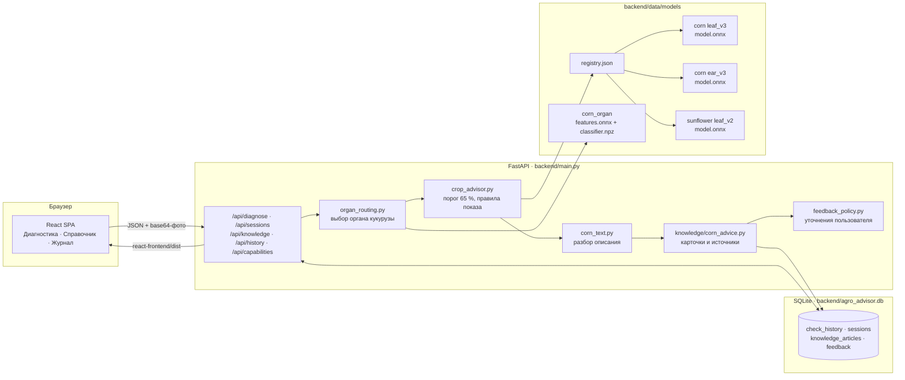
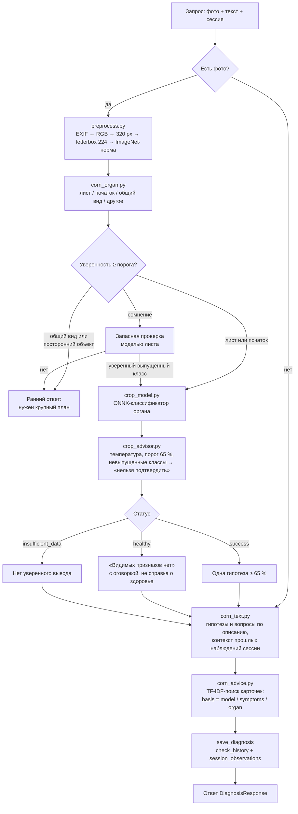
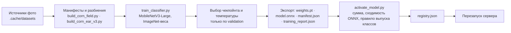

# Agronom AI — Помощник агронома

Локальное приложение для предварительной диагностики болезней **кукурузы** и
**подсолнечника** по фотографии и описанию симптомов. Работает целиком на
обычном компьютере без GPU и без внешних API: нейросети запускаются на CPU через
OpenCV, история хранится в SQLite, интерфейс открывается в браузере.

Приложение не заменяет агронома: оно показывает, на что похож снимок в пределах
обученных классов, честно говорит «нет уверенного вывода», когда порог не
достигнут, и подбирает карточки рекомендаций с источниками.

## Содержание

- [Возможности](#возможности)
- [Стек технологий](#стек-технологий)
- [Архитектура](#архитектура)
- [Как проходит проверка](#как-проходит-проверка)
- [Модели](#модели)
- [Обучение и включение модели](#обучение-и-включение-модели)
- [База знаний](#база-знаний)
- [Хранение данных](#хранение-данных)
- [API](#api)
- [Интерфейс](#интерфейс)
- [Запуск](#запуск)
- [Разработка и проверки](#разработка-и-проверки)
- [Структура репозитория](#структура-репозитория)
- [Ограничения](#ограничения)

## Возможности

- **Диагностика по фото.** Лист и початок кукурузы, лист и корзинка подсолнечника.
  Орган кукурузы определяется автоматически, переключатель не нужен.
- **Разбор текста.** Описание симптомов превращается в гипотезы для проверки и
  уточняющие вопросы; текст никогда не выдаётся за диагноз по фото.
- **Сессии обследований.** Наблюдения одного растения копятся в сессии: новые
  фото и ответы на вопросы учитывают предыдущие записи.
- **Карточки рекомендаций.** Русскоязычные инструкции по болезням кукурузы с
  ссылками на источники; для неуверенных снимков показываются отдельно от
  раздела «Что делать».
- **Уточнение диагноза пользователем.** Отметка сохраняется для проверки и
  будущего обучения, спорный результат убирается из показа, но история не
  переписывается.
- **Полевой журнал и справочник** в интерфейсе-«телефоне», одинаково удобном на
  мониторе и смартфоне.

## Стек технологий

| Слой | Технология | Зачем |
| --- | --- | --- |
| Интерфейс | React 19, Vite 8, Tailwind CSS 4, lucide-react | Одностраничное приложение, собирается в `react-frontend/dist` и отдаётся сервером |
| API | FastAPI, Pydantic 2, Uvicorn | HTTP-эндпоинты, строгие схемы запросов и ответов |
| Хранение | SQLite + SQLAlchemy 2 | История проверок, сессии, карточки знаний, уточнения пользователей |
| Инференс | OpenCV DNN (`cv2.dnn.readNetFromONNX`), NumPy | Запуск ONNX-моделей на CPU без PyTorch в рантайме |
| Классификаторы | MobileNetV3-Large, дообученная целиком, экспорт в ONNX (opset 17) | Болезни листа и початка кукурузы, листа подсолнечника |
| Определитель органа | MobileNetV3-Large как извлекатель признаков (960) + логистическая регрессия с температурной калибровкой | Лист / початок / общий вид / посторонний объект |
| Поиск по знаниям | scikit-learn TF-IDF (символьные n-граммы 3–5) + косинусное сходство | Подбор карточек по описанию симптомов |
| Обработка фото | Pillow, OpenCV | EXIF-поворот, уменьшение, letterbox 224×224, нормализация ImageNet |
| Обучение (отдельно) | PyTorch 2, torchvision, ONNX, scikit-learn, SciPy | Скрипты в `backend/scripts`, зависимости в `requirements-training.txt` |
| Проверки | `unittest` (бэкенд), `node --test` и oxlint (фронтенд) | Тесты не трогают рабочую базу: используют временный файл |

Платформа: Windows, Python 3.12, Node 24. Рантайм не требует PyTorch, CUDA и
интернета.

## Архитектура



Три принципа, вокруг которых построен код:

1. **Одна подготовка изображения на обучение и сервер**
   (`backend/app/diagnostics/preprocess.py`). Иначе сеть на сервере видит не то,
   на чём училась.
2. **Модель запускается только из реестра** `registry.json`, со статусом
   `approved` и совпавшей контрольной суммой `model.onnx`. Если модели нет,
   сервер отвечает именно так, а не подставляет другую.
3. **История не переписывается.** Проверки, фотографии и уточнения добавляются,
   но не меняются; меняются только правила их показа.

## Как проходит проверка

Запрос `POST /api/diagnose` содержит культуру, фазу, часть растения, текст и
фото в base64. Ниже — путь запроса по кукурузе; подсолнечник проходит те же
шаги без определителя органа и разбора текста.



Что происходит на каждом шаге:

| Шаг | Модуль | Что выполняется |
| --- | --- | --- |
| Подготовка фото | `diagnostics/preprocess.py`, `vision.py` | Декодирование base64, поворот по EXIF, уменьшение до 320 px, вписывание в серый квадрат 224×224, нормализация. Снимки короче 96 px отклоняются |
| Выбор органа | `diagnostics/corn_organ.py`, `organ_routing.py` | Признаки MobileNetV3 → логистическая регрессия с температурой. Уверенный «лист»/«початок» идёт к своей модели; «общий вид» получает просьбу переснять; при сомнении спрашивается модель листьев, и только её уверенный выпущенный класс принимается |
| Классификация | `diagnostics/crop_model.py` | Загрузка ONNX из реестра с проверкой суммы и статуса, softmax с температурой из манифеста. Вероятность невыпущенных классов собирается в `unvalidated` |
| Порог и правила | `diagnostics/crop_advisor.py` | Принимается одна гипотеза ≥ 65 %. Класс «здоровый» показывается зелёным статусом с оговоркой; описание повреждений в тексте его отменяет |
| Разбор текста | `diagnostics/corn_text.py` | Правила по ключевым словам (наросты, налёт, пустулы, пятна) дают гипотезы для проверки и вопросы. Без фото ответ всегда `insufficient_data` |
| Карточки | `knowledge/corn_advice.py`, `knowledge/search.py` | При принятой гипотезе — карточка по метке модели, её рекомендации и источники попадают в «Что делать». Иначе карточки по описанию или общий осмотр початка показываются как справка |
| Сохранение | `main.py` → `storage/investigations.py` | Запись в `check_history`, привязка к сессии (новой или указанной), снимок результата с суммой манифеста модели |
| Показ истории | `crop_advisor.apply_crop_display_policy`, `feedback_policy.py` | Старые записи переименовываются в актуальные названия классов, оспоренные пользователем результаты убираются из показа |

## Модели

Активные модели перечислены в `backend/data/models/registry.json`
(`{культура: {орган: каталог}}`). Каждый каталог содержит `model.onnx`,
`manifest.json` (формат `onnx_logits_v1`: классы, температура, выпущенные
классы, контрольная сумма), `training_report.json` (метрики по источникам,
все предсказания теста) и копии разбиений.

| Культура / орган | Каталог | Выпущенные классы | Качество на отложенном тесте |
| --- | --- | --- | --- |
| Кукуруза, лист | `corn_candidates/leaf_v3` | обыкновенная ржавчина, серая пятнистость, здоровый лист | Здоровые листья на чужих источниках: Ecuador 138/138, IDADP 100/100; ржавчина 81 %. Гельминтоспориозы и курвуляриоз остаются невыпущенными: на чужих источниках почти не распознаются |
| Кукуруза, початок | `corn_candidates/ear_v3` | пузырчатая головня, гниль початка (без вида), початок без признаков болезни | 95 % точности, precision и recall всех классов > 0,88. Данные: iNaturalist, IDADP, HF ricemaize, 117 вручную отобранных здоровых початков с Wikimedia Commons |
| Кукуруза, орган | `corn_organ` | лист, початок, общий вид, другое | Грубый фильтр на 737 снимках; его сомнение не блокирует диагностику (см. схему) |
| Подсолнечник, лист и корзинка | `sunflower_candidates/leaf_v2` | ложная мучнистая роса, серая гниль, повреждения листьев, здоровый лист | 92,5 %; единственная путаница — часть повреждений листьев принимается за ложную мучнистую росу |

Прежние классификаторы на замороженном MobileNetV2 удалены: на внешних полевых
фотографиях кукурузы они давали около 33 % точности и называли здоровые листья
больными. Сохранённые результаты тех проверок остаются в истории как наблюдения.

## Обучение и включение модели



Рецепт обучения: 2 эпохи учится только голова (lr 1e-3), затем вся сеть с
малым шагом (1e-4) и косинусным затуханием, AdamW, label smoothing 0,05,
сбалансированная по классам и источникам выборка, аугментации
(отражения, поворот до 30°, сдвиг и масштаб, ColorJitter, лёгкое размытие). Тест считается один раз в конце.
Класс выпускается, если в тесте ≥ 15 примеров и precision и recall ≥ 0,70;
`--classes` позволяет задать список вручную, и это решение фиксируется в
манифесте.

```powershell
# Подсолнечник: папки-классы, разбиение по группам похожих снимков.
python backend/scripts/train_classifier.py --crop sunflower --folder ".cache/datasets/sunflower/images/Original Image" --splits-from backend/data/models/sunflower/training_report.json --output backend/data/models/sunflower_candidates/leaf_next
# Кукуруза: манифесты corn_field с фильтром по органу.
python backend/scripts/train_classifier.py --crop corn --manifests .cache/datasets/corn_field/manifests --organ leaf --output backend/data/models/corn_candidates/leaf_next
# Прерванный запуск: оценить и экспортировать лучший чекпойнт без переобучения.
python backend/scripts/train_classifier.py --crop corn --manifests .cache/datasets/corn_field/manifests --organ leaf --output backend/data/models/corn_candidates/leaf_v3 --evaluate-only
# Включение кандидата в реестр.
python backend/scripts/activate_model.py backend/data/models/sunflower_candidates/leaf_next
```

Обучение идёт на CPU (по умолчанию 8 потоков, 12 эпох, ~17 МБ весов на модель). Для него нужны
зависимости из `requirements-training.txt`; сервер их не использует.

## База знаний

- `backend/data/knowledge/corn.json` — 10 проверенных карточек по кукурузе
  (ржавчина, серая пятнистость, гельминтоспориозы, головня, гнили початка,
  осмотр початков) с симптомами, рекомендациями и ссылками на источники.
  Для каждой карточки указано, какие органы и метки модели она покрывает.
- `potato.json`, `bashinkom.json` — унаследованный справочник по картофелю;
  картофель в интерфейсе не предлагается, модуль сохранён для совместимости.
- При старте сервер досевает карточки в таблицу `knowledge_articles`, не
  трогая уже существующие записи.
- Поиск: TF-IDF по символьным n-граммам (3–5) и косинусное сходство текста
  описания с текстом карточек. Сходство текста никогда не превращается в
  уверенность по фото.

## Хранение данных

SQLite-файл `backend/agro_advisor.db`, таблицы описаны в
`backend/app/storage/models.py`:

| Таблица | Содержимое |
| --- | --- |
| `check_history` | Каждая проверка: культура, фаза, текст, фото (base64), статус, снимок ответа `result_json` с суммой манифеста модели |
| `investigation_sessions`, `session_observations` | Сессия обследования и её наблюдения; старые проверки без сессии получают свою при старте (`backfill_sessions`) |
| `knowledge_articles`, `knowledge_fetches` | Карточки рекомендаций и дата их получения |
| `diagnosis_feedback` | Уточнения пользователей: предложенные метки, орган, заметки, статус проверки. Только добавление, не метки для обучения |

## API

| Метод и путь | Назначение |
| --- | --- |
| `POST /api/diagnose` | Проверка: `crop`, `growth_stage`, `symptoms`, `image_base64`, `plant_part` (`auto` для кукурузы), необязательный `session_id`. Ответ — `DiagnosisResponse` |
| `GET /api/sessions?limit=` | Список сессий с числом наблюдений |
| `GET /api/sessions/{id}` | Сессия с наблюдениями, фотографиями и актуальными правилами показа |
| `GET /api/history?limit=&crop=` | Плоская история проверок |
| `GET /api/capabilities` | Органы и классы установленных моделей по культурам |
| `GET /api/knowledge?crop=` | Карточки справочника и метки модели |
| `GET /api/feedback/labels` | Категории для уточнения диагноза |
| `GET`/`POST /api/history/{check_id}/feedback` | Уточнение пользователя к проверке кукурузы с фото |
| `GET /` и `/assets/*` | Собранный интерфейс из `react-frontend/dist` |

Схемы запроса и ответа: `backend/app/schemas.py`. Интерактивная документация
доступна на `http://127.0.0.1:8000/docs` после запуска.

## Интерфейс

Оформление повторяет макет [agro-helper-test](https://github.com/NikitaUwu/agro-helper-test):
экран-«телефон» по центру на широком мониторе, шапка с индикатором связи,
нижняя навигация.

| Вкладка | Что показывает |
| --- | --- |
| Диагностика | Камера или загрузка фото, описание симптомов, культура, фаза и часть растения. Во время ответа сервера — анимация сканера без выдуманных процентов |
| Сессия | Наблюдения и карточки заключений с разделами «Вывод», «Гипотезы», «Что делать», «Справочник»; поле для дополнения той же сессии; форма уточнения диагноза |
| Справочник | Карточки `/api/knowledge` с поиском и классы установленных моделей |
| Полевой журнал | Сессии с сервера с фильтром по культуре |

Адрес `#catalog`, `#journal` или `#session=<id>` открывает нужный экран сразу.
Подробнее: `react-frontend/README.md`.

## Запуск

Windows, Python 3.12, Node 24. После подготовки достаточно открыть `start.bat`.

```powershell
python -m pip install -r requirements.txt
npm.cmd ci --prefix react-frontend
npm.cmd run build --prefix react-frontend
python -m uvicorn main:app --app-dir backend --reload
```

Откройте http://127.0.0.1:8000. После изменения интерфейса повторите сборку;
в разработке `npm.cmd run dev --prefix react-frontend` проксирует `/api` на
сервер.

## Разработка и проверки

```powershell
# Бэкенд: из корня проекта; тесты используют временную базу, рабочая не затрагивается.
python -m unittest discover -s backend/tests
# Фронтенд
npm.cmd run lint --prefix react-frontend
cd react-frontend; node --test; cd ..
# Аудит места; --apply удаляет только разрешённые копии и кэш.
python backend/scripts/optimize_storage.py
# Компактная копия без обучающих фотографий и PyTorch.
python backend/scripts/export_runtime.py
```

Не удаляйте `.cache/datasets` целиком: часть оригиналов фотографий есть только
там. `.cache/thumbnails` пересоздаются.

## Структура репозитория

| Путь | Назначение |
| --- | --- |
| `backend/main.py` | Эндпоинты, сборка ответа, сохранение проверок |
| `backend/app/schemas.py` | Pydantic-схемы запроса и ответа |
| `backend/app/crops.py`, `corn_taxonomy.py` | Активные культуры, органы, ключи и русские названия классов |
| `backend/app/diagnostics/` | Подготовка фото, определитель органа, классификаторы, порог, разбор текста, правила показа |
| `backend/app/knowledge/` | Карточки, TF-IDF-поиск, подбор рекомендаций |
| `backend/app/storage/` | Таблицы SQLite и сессии |
| `backend/scripts/` | Сбор и проверка датасетов, обучение, активация, аудит, экспорт рантайма |
| `backend/tests/` | Проверки сервера, датасетов, обучения и сессий |
| `backend/data/models/` | Реестр, веса, манифесты и отчёты моделей |
| `backend/data/datasets/` | Разметка, лицензии, разбиения и галереи (без оригиналов) |
| `backend/data/knowledge/` | Справочные материалы |
| `react-frontend/` | Интерфейс (React + Vite + Tailwind) |
| `docs/` | Заметки по датасетам, определителю органа, початкам и сравнению моделей |
| `.cache/` | Оригиналы фото, уменьшенные копии, временные артефакты |

## Ограничения

- Модели покрывают ограниченный набор классов; вероятность невыпущенных
  классов показывается как «нельзя подтвердить причину».
- Статус «видимых признаков нет» не подтверждает здоровье растения, а лишь
  говорит, что в пределах классов модели признаков не найдено.
- Вид гнили початка модель не различает; гельминтоспориозы кукурузы требуют
  примеров из разных источников, прежде чем их можно будет выпустить.
- Лабораторные метрики относятся к отложенным тестам; на снимках с другого
  предприятия, освещения и запылённости точность нужно проверять отдельно.

Подробнее: [определение объекта](docs/МОДЕЛЬ_ОРГАНОВ_КУКУРУЗЫ.txt),
[початки и сессии](docs/ПОЧАТКИ_И_СЕССИИ.txt),
[датасеты](docs/ДАТАСЕТЫ_КУКУРУЗЫ.txt),
[сравнение моделей](docs/СРАВНЕНИЕ_МОДЕЛЕЙ_КУКУРУЗЫ.txt).
